  

### Hi, I'm Ethan

I'm a computer science student at RIT, graduating in May 2027. I work in software engineering and data science, and I'm currently a year-round R&D intern at Sandia National Laboratories.

**Portfolio:** [ch4ngs4n1ty.github.io/My-Personal-Portfolio](https://ch4ngs4n1ty.github.io/My-Personal-Portfolio/) · **LinkedIn:** [echang0970](https://www.linkedin.com/in/echang0970) · **Email:** echang0970@gmail.com

#### Selected projects

- **[PlayIQ](https://github.com/ch4ngs4n1ty/Sports-Data-Visualization)** ([live demo](https://sports-data-visualization.vercel.app/)): a sports analytics dashboard for six leagues, with Log5, Poisson, and Binomial projections and an XGBoost model retrained in GitHub Actions.
- **[Chroma](https://github.com/ch4ngs4n1ty/Chroma)**: a charity crowdfunding platform built with a team of four. Angular front end, Spring Boot REST API, JUnit tests.
- **[Stock Dip Analysis API](https://github.com/ch4ngs4n1ty/Stock-Market-Analysis)**: a TypeScript and Express service that scores stock dips from price, RSI, and news, running in Docker with PostgreSQL.
- **[Secure Distributed Messenger](https://github.com/elc6696/Secure-Distributed-Messenger)**: a peer-to-peer encrypted chat app in C#, using AES-256 with keys exchanged over RSA-2048.

#### What I work with

Python, Java, SQL, JavaScript, TypeScript, C, C#, React, Node.js, Spring Boot, pandas, scikit-learn, PostgreSQL, Docker, GitHub Actions
